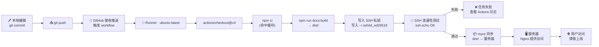

# 用 GitHub Actions 自动化部署 VitePress 博客

写完博客要手动 FTP 上传、登服务器刷新,链路长、容易断。这篇文章用 **GitHub Actions + SSH + rsync** 把这件事压成 `git push` 一行命令,端到端耗时 30~60 秒。

## 一、整体流程

动手前先把整条链路看清楚——后面所有配置都对得上这张图。

### 完整流程图(Mermaid)



### ASCII 速览

```
本地  ──git push──▶  GitHub  ──webhook──▶  Runner
                                              │
                                    checkout → npm ci → build
                                              │
                                          ssh test
                                              │
                                            rsync
                                              ▼
                                         服务器 · Nginx
```

### 各环节耗时与关键命令

| 环节         | 耗时       | 关键产物 / 命令                   | 失败常见原因                |
| ------------ | ---------- | --------------------------------- | --------------------------- |
| 触发 + 拉取  | 5~10 s     | `on: push: branches: [main]`      | 分支名不匹配                |
| 安装依赖     | 10~20 s    | `npm ci`(命中缓存更快)            | `package-lock.json` 缺失    |
| 静态构建     | 15~25 s    | `docs/.vitepress/dist/`           | 路径或脚本名错              |
| SSH 连通测试 | 2~3 s      | `ssh ... echo OK`                 | 密钥未写入 `authorized_keys` |
| rsync 同步   | 3~10 s     | `rsync -avz --delete`             | 端口、目录权限问题          |

理解了链路,再开始配置密钥和 Secrets。

## 二、准备工作

**1. 在服务器生成密钥对**(目标服务器执行):

```bash
ssh-keygen -t ed25519 -f ~/.ssh/github_deploy -C "github-actions"
cat ~/.ssh/github_deploy.pub >> ~/.ssh/authorized_keys
```

**2. 在 GitHub 仓库配置 Secrets**

`Settings → Secrets and variables → Actions → New repository secret`:

| 名称              | 值                                  |
| ----------------- | ----------------------------------- |
| `SSH_PRIVATE_KEY` | 私钥全文(含 BEGIN/END)              |
| `SSH_HOST`        | 服务器 IP 或域名                    |
| `SSH_USER`        | 登录用户                            |
| `SSH_PORT`        | SSH 端口                            |
| `DEPLOY_PATH`     | 网站目录绝对路径                    |

## 三、workflow 文件

在仓库根目录创建 `.github/workflows/deploy.yml`:

<div v-pre>

```yaml
name: Deploy
on:
  push:
    branches: [main]
  workflow_dispatch:

jobs:
  deploy:
    runs-on: ubuntu-latest
    steps:
      - uses: actions/checkout@v4

      - uses: actions/setup-node@v4
        with:
          node-version: 20
          cache: npm

      - run: npm ci
      - run: npm run docs:build

      - name: 写入 SSH 私钥
        run: |
          mkdir -p ~/.ssh
          printf '%s' "$SSH_PRIVATE_KEY" > ~/.ssh/id_ed25519
          chmod 600 ~/.ssh/id_ed25519
        env:
          SSH_PRIVATE_KEY: ${{ secrets.SSH_PRIVATE_KEY }}

      - name: 测试连通
        run: |
          ssh -i ~/.ssh/id_ed25519 -p ${{ secrets.SSH_PORT }} \
              -o StrictHostKeyChecking=no \
              ${{ secrets.SSH_USER }}@${{ secrets.SSH_HOST }} echo OK

      - name: rsync 部署
        run: |
          rsync -avz --delete --ignore-errors \
            --filter='P .user.ini' \
            --filter='P .htaccess' \
            -e "ssh -p ${{ secrets.SSH_PORT }} -i ~/.ssh/id_ed25519 -o StrictHostKeyChecking=no" \
            docs/.vitepress/dist/ \
            ${{ secrets.SSH_USER }}@${{ secrets.SSH_HOST }}:${{ secrets.DEPLOY_PATH }}
```

</div>

跑一次试试:`git push origin main`,打开仓库的 **Actions** 页签看每一步的执行日志。
